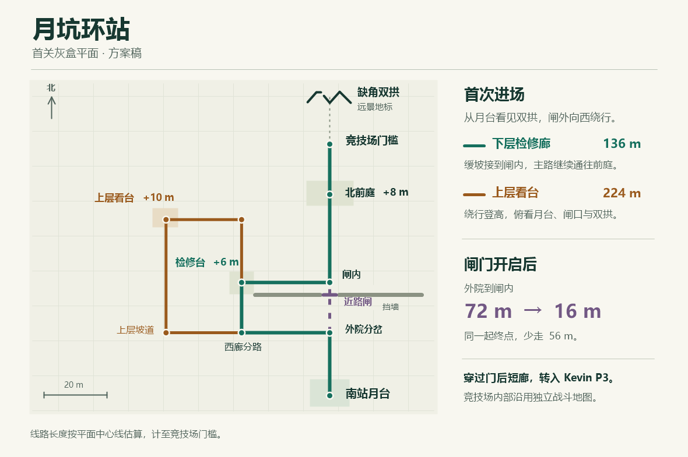

# 箱庭世界与首关设计

**月坑环站**（暂名）。玩家从南站月台出发，第一眼看见北面竞技场缺了一角的双拱。沿直路走到闸门，能看见门栓在另一面。西侧有两条绕行路线，其中一条可以登高俯瞰门的两侧。从里面踩下踏板开闸时，能隔着门认出刚才出发的月台。最后走进双拱，转入已有的 Kevin P3 战斗地图。

## 在 UE 5.9 试玩

打开 `F:/ue_project/GGYGO_UE59/GGYGO.uproject`，在内容浏览器打开 `/Game/Map/LunarStation/L_LunarStation`，点击播放，从南站的 PlayerStart 出发。第一道闸门只从内侧开启。上层看台可以回望整条路线。闸门开启后可以返回月台，再穿过北侧短廊进入 P3。

上下两路已分别用生产 Pyrios 在单机 D3D12 中走通，均在 P3 遇到唯一的 Kevin，玩家首次命中后其生命从 1200 降至 1190。下层覆盖持键过门、释放后重新移动，上层覆盖进入战场后先打出普攻。实拍位于 5.9 副本的 `Saved/Codex/LunarStation/20261119_095012539_Lower/Lower.mp4` 和 `Saved/Codex/LunarStation/20261119_095245494_Upper/Upper.mp4`。首次玩家能否在 10 秒内认出目的地，仍待真人试玩。

录像之后为检修坡折返点补了一段护栏，最终版已实走上下坡、在短廊触发线前折返，再进 P3 命中。实走点位间的距离折算约为绕行 69.3 米、开闸后 15.5 米。下文放样表保留设计尺寸。[5.9 副本试玩记录与复现命令](https://github.com/WuDuElysia/GGYGO/blob/20d281a/AAADocs/需求文档/月坑环站灰盒试玩.md)

## 世界结构

| 区域 | 玩家在这里做什么 | 空间关系与本轮范围 |
| --- | --- | --- |
| 南站月台 | 出发、认方向；开闸后从这里快速重走 | 位于坑沿南侧。月台的水平长顶棚是回望地标。首关搭可走的站台和出口。 |
| 西侧检修环 | 选择走下层连廊，或沿坡去上层看台；两路在检修台重新汇合 | 绕过隔开内外院的挡墙。上层能看到下层路线、闸门背面和北边双拱。首关搭两条完整通路。 |
| 北侧竞技场前庭 | 会合、回看捷径，辨认并走进竞技场入口 | 首关搭外侧台阶轮廓、无障碍坡面、门洞与双拱剪影。门洞是两张地图的交接处，战斗空间由独立 P3 提供。 |
| 东侧后续城区 | 为下一段箱庭留出从前庭向东延伸的方向 | 远景只搭低矮的成排屋顶，前景以连续女儿墙收边。是否开放、通向什么内容，留待后续世界设计。 |

## 首关平面与放样



图中上北下南，左西右东。字母对应下表；实线为步行路线，`#` 为关闭的闸门，`:` 指向远景。图示表达连通关系，搭建尺寸以坐标为准。**表内均为米，导入 UE 坐标时乘 100。+X 向北，+Y 向东，Z 取可走表面标高。**

```text
                              N (+X)
                                ^
                                L
                                :
                                T
                                |
                                H                east skyline
                                |
    O-------------V             |
    |             |             |
    |             W2------------I
    |             |             K #
    Q-------------W1------------B
                                |
                                A
```

| 点位 | X / Y / Z（m） | 灰盒尺寸与用途 |
| --- | --- | --- |
| A 南站出生点 | 0 / 0 / 4 | 12 × 10 m 平台，PlayerStart 面北。顶棚在玩家身后结束，正前方留出宽 8 m 的视线。 |
| B 外院分岔 | 20 / 0 / 4 | 10 × 8 m。北边是闸，西边的 6 m 宽路穿过挡墙西端的回廊。 |
| K 捷径闸门 | 32 / 0 / 4 | 闸口净宽 4 m、门楣标高 8 m；门栓朝北。挡墙与门扇对齐，外侧能看见门另一边的横栓。 |
| W1 西廊分路 | 20 / −28 / 4 | 8 × 8 m。向北转是 6 m 宽的短坡，向西直行是 4 m 宽的上看台支路。 |
| Q、O、V 上层支路 | Q 20 / −52 / 4；O 56 / −52 / 10；V 56 / −28 / 10 | Q→O 用 36 m 升 6 m。O 放 8 × 6 m 看台，矮栏给南站和闸门留视线。O→V 沿坑缘平走，V→W2 用 20 m 降 4 m。 |
| W2 检修台 | 36 / −28 / 6 | 8 × 8 m。W1→W2 用 16 m 升 2 m；从上层下来的玩家也在此看到内侧门栓。向东 28 m 缓降至 I。 |
| I 闸内操作位 | 36 / 0 / 4 | 10 × 8 m。南侧 4 m 即闸门，北侧正对前庭坡道。给开门和回头留出站位。 |
| H 北前庭 | 64 / 0 / 8 | I→H 用 28 m 升 4 m。前庭 16 × 12 m，可停步看门，也能回望月台。 |
| T 竞技场门槛 | 80 / 0 / 8 | 门洞净宽 6 m、净高 6 m，过门后留 4 m 深的短廊，再放转图触发面。 |
| L 双拱远景 | 96 / 0 / 顶部 26 | 宽约 24 m，西拱切去上角，缺口在天空上读出。用体块组成前庭外观；P3 的 Actor 坐标属于另一张地图。 |

先放 A、K、T、L，从生产玩家视角对齐门楣和远景，确保能越过闸顶看到两座拱之间的缺口。再铺 W1→W2→I 与 Q→O→V 两条路，最后封挡墙。挡墙横穿 B、I 之间，从主路西侧回廊连续延伸到东侧坑壁，**西端在 W1→W2 通路前收头**，避免误封下层路线。所有坡长按水平投影量取，转角平台与坡道端面齐平；支路最大坡度为 V→W2 的 1:5。可走门洞至少留 4 m 净高和完整相机回转空间。

## 一次完整游玩

1. **先看到目的地。** 从 A 沿直路到 B。闸外只露出竞技场上部，门缝能看到对侧横栓。沿挡墙往西看，连续的地面与门洞把视线引到 W1。
2. **选择绕行。** W1 北面的缓坡直接到 W2。若继续向西，Q 的折返坡会把人送到 O；从这里能同时指出刚走过的月台、挡墙两侧和缺角双拱。沿 V 下降回到 W2。支路的第一份回报是看懂整个空间，灰盒能单独验证这一点。
3. **亲手接通来路。** 从 W2 向东走到 I 时，右手就是闸门内侧；站到门栓旁可看见正南方 A 的长顶棚。灰盒提案用内侧检修踏板带动横栓，门扇收入侧墙。先穿回 B，再从 B 原路返回 I，验证开启后可双向通行。外侧接近时门保持关闭。闸门在本次访问期间保持开启。
4. **走进同一座双拱。** 从 I 向北上坡到 H，拱脚逐渐露出；T 地面沿同一种铺装延伸进短廊。越过廊内的触发面后进入 `/Game/Map/BH3/L_KevinBoss_P3`，由目的地现有 PlayerStart 和 Encounter 接手。测试终点是玩家已能移动、场内只有一个 Kevin 并能开始原有交战。

按道路中心线计算，A→T 走下层约 **136 m**，走上层约 **224 m**，均未计停留、探闸和转图短廊。首次由 B 经下层抵达 I 为 **72 m**，开闸后 B→I 为 **16 m**。重走的人能在相同起终点直接感到少走了 56 m。

## 地标与灯光

- **远看缺角，近看拱脚。** 双拱以天空作背景，主路中轴两侧的立面压低。关掉局部引导灯仍应认得缺角；若从 A 看不见，优先调整前景遮挡和轮廓。
- **下层看连续边线，上层看天光。** 主路沿内侧做一条连续浅色路缘。支路入口略窄，坡顶露出天空，上看台用间隔护栏表现高度。玩家可以凭形状和明暗做选择。
- **门栓显示通断。** 闸外看见横栓挡住门扇，内侧踏板紧靠横栓。闸开后门框内直接出现南站顶棚。用一盏暖色检修灯照亮机构，门状态由门扇位置表达。
- **角色受光。** 灰盒外景沿用项目的单一 `GGYGO.KeyLight` 主光约定，在 B、O、H 分别观察角色正背面与地面接触。前庭最高亮度留给拱外天空，门洞地面保持可辨。P3 继续使用其已验收的主光与补光。

## 现有基础与待评审决定

已在 `F:/ue_project/GGYGO_UE59` 的 5.9 副本核对下列文件。该副本已有 P1、P3 两张地图，P1 的 `StaticMeshes` 目录有 77 个导入网格及 1 个支撑包，P3 有 97 个导入网格及 1 个支撑包。P1 的 `G1580596618864_Stage_KevinbossP1_City_BuildingMain_01A` 可供下一轮对照建筑比例。本轮放样采用普通方块、斜坡和门洞。

| 可复用的基础 | 副本内核实的位置与证据 |
| --- | --- |
| 玩家与默认体验 | `Content/BP/Character/Player/BP_PC_Pyrios.uasset`、`Content/BP/GamePlay/BP_GameMode.uasset`、`Content/System/Experiences/DA_Experience_Default.uasset`。 |
| Kevin 目的地 | `Content/Map/BH3/L_KevinBoss_P3.umap`、`Content/Characters/Boss/Kevin/DemonBattle/Data/DA_Boss_Kevin_DemonBattle.uasset`。场景配置给出玩家与 Boss 初始间距 18 m、开局生成 Encounter 中的 Boss。 |
| 已有运行结果 | 本关验证到跨图后玩家命中 Kevin。P3 两阶段完整交战、死亡和清理由此前的 5.9 验收覆盖。[5.9 分支迁移验收](https://github.com/WuDuElysia/GGYGO/blob/codex/ue59-migration/AAADocs/需求文档/ue59_migration.md) · [Kevin 场景与战斗](kevin_boss_assembly.md) |

灰盒已实现南站、检修环、双拱、内侧踏板和门后转图。下表中间一栏为当前可玩版本的取舍，主动交互、额外奖励及跨图存储留待后续玩法评审。

| 决定 | 灰盒建议 | 对下一轮制作的影响 |
| --- | --- | --- |
| 开门是否需要主动交互 | 先踩内侧踏板；另一方案是面对横栓主动操作 | 主动操作需要明确使用哪个交互输入，以及玩家如何发现操作位。 |
| 上层支路给什么回报 | 首轮只给观察位置，可与“增加一个探索物”对比 | 若加探索物，另定奖励内容、领取和重复访问规则。 |
| 重进、落败和战后去向 | 首轮验证同次访问开闸、单向进入 P3 并开始交战 | 跨图保留闸门、死亡重试点、胜利返程及队伍状态继承，须先定玩法和存储范围。 |

## 整批灰盒试玩标准

在 5.9 的独立灰盒图中用生产 Pyrios 和正常游戏镜头整段试玩。两条路线从各自独立的出生开始，分别记录开门、折返和进入 P3 的结果。下表保留灰盒的复测标准。

| 检查 | 通过条件 |
| --- | --- |
| 出生定向 | 3 名首次试玩者中至少 2 人在 10 秒内指出双拱为目的地，并能从 B 找到西侧通路。记录第一眼误认的物件，供调整构图。 |
| 分路与回收 | 两条路线均可用普通移动走通；上层玩家在 O 能辨认月台、闸和竞技场，并沿 V 自然回到 W2。双向走过最陡坡与转角，胶囊无卡滞，正常镜头能看清路面。 |
| 捷径有用 | 首次从 B 正面接近闸门仍受阻；在 I 抽栓后能连续 I→B→I。两次均从 B 量到 I，开启后路程小于初次下层路线的三分之一。 |
| 转图接战 | 在 H 回望仍能认出月台，面北能认出同一双拱。停在短廊触发面前可折返；穿过后只转图一次，在 P3 正常出生、能移动且只出现一个 Kevin，能用原有能力命中。 |
| 整批判定 | 步行、支路、开闸或跨图接手任一项失败，记录点位和画面，修正后重走受影响路段。P3 既有战斗回执供对照，首关连通性以这次完整游玩为准。 |
